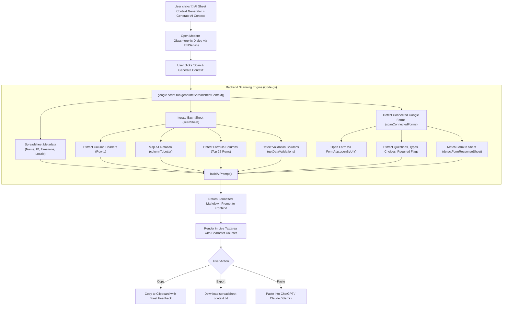

# 🤖 AI Sheet Context Generator — Intelligent Workspace Prompt Architect

[](https://developers.google.com/apps-script)
[](https://workspace.google.com/products/sheets/)
[](https://workspace.google.com/products/forms/)
[](https://tailwindcss.com/)
[](../../LICENSE)

An in-sheet Google Apps Script utility that automatically inspects active spreadsheet workbooks, individual sheet tabs, column headers, formula structures, data validation rules, and connected Google Forms, converting them into structured, high-context prompts optimized for Large Language Models (LLMs) such as Claude, ChatGPT, Gemini, and DeepSeek.

---

## 💡 Why AI Sheet Context Generator?

When developers or non-technical operators ask an AI model to write automations, formulas, or Apps Script code for their Google Sheets, the AI typically lacks essential environmental context. This results in frequent errors and hallucinations:
- **Hardcoded Column Assumptions**: Generating scripts that target column index `[3]` or hardcoded column `D` instead of dynamically finding headers by name.
- **Accidental Formula Overwrites**: Generating batch write routines that overwrite columns containing critical formulas.
- **Data Validation Violations**: Generating automated updates that break dropdown constraints or data validation rules.
- **Broken Form Disconnects**: Failing to account for connected Google Forms where new submissions populate a separate response sheet.

**AI Sheet Context Generator** eliminates prompt guesswork by automatically performing a deep, non-destructive introspection of your workbook in seconds, packaging the schema into an actionable, structured markdown prompt ready for LLM consumption.

---

## ✨ Key Features

- **⚡ Deep Spreadsheet Introspection**: Automatically collects workbook metadata (Title, ID, URL, Timezone, Locale) and sheet dimensions (used rows/columns, maximum rows/columns, frozen rows/columns).
- **🔍 Dynamic Column & Header Mapping**: Reads row 1 column headers across all sheets and maps them to both 1-based numeric indices and standard A1 notation column letters (e.g. `A`, `B`, ..., `AA`).
- **📐 Formula & Calculation Detection**: Inspects sample data rows (up to 25 rows) across every column to identify which columns contain formulas (starting with `=`), preventing automated scripts from destructively replacing formula logic.
- **🛡️ Data Validation Rules Awareness**: Scans columns for data validation rules (dropdown lists, numeric ranges, date limits) to ensure generated scripts respect sheet constraints.
- **📝 Connected Google Forms Introspection**:
  - Automatically identifies linked Google Forms (`SpreadsheetApp.getFormUrl()`).
  - Fetches form titles, descriptions, and item schemas via `FormApp`.
  - Parses question types (`TEXT`, `PARAGRAPH_TEXT`, `MULTIPLE_CHOICE`, `CHECKBOX`, `LIST`, `SCALE`, `DATE`, `DATETIME`, `TIME`, `DURATION`).
  - Extracts choice options, scale ranges, and required field statuses.
  - Matches form question titles against sheet headers to identify the exact target response sheet.
- **🎨 Glassmorphic Modal UI**:
  - Built with **Tailwind CSS**, modern typography (**Bricolage Grotesque**, **Geologica**, **Google Sans Code**), and **Lucide** icons.
  - Features real-time scanning feedback, animated loaders, and non-intrusive status toast alerts.
  - Live character counter with formatted output preview.
- **📋 Export & Clipboard Integration**:
  - 1-click **Copy prompt to clipboard** with modern `navigator.clipboard` and legacy fallback.
  - 1-click **Export .txt** for local prompt archiving.
  - Editable in-sheet textarea to customize instructions before copying.
- **🤖 Baked-in Prompt Engineering Directives**: Embeds strict system instructions enforcing dynamic header mapping, schema strictness, production-readiness, and non-destructive execution.

---

## 🔄 Workflow Architecture



---

## 📄 Generated Context Prompt Structure

The generated prompt is formatted in clean Markdown, ready to be pasted directly into any LLM:

```markdown
Act as an elite Google Apps Script engineer and Workspace automation architect. Your objective is to analyze, debug, optimize, or construct robust automations for the provided Google Sheets environment.

## CORE SYSTEM DIRECTIVES
1. Schema Strictness: Strictly adhere to the existing spreadsheet architecture. Do not alter provided sheet names, data structures, or header labels.
2. Dynamic Referencing: Always map columns dynamically by matching header names. Never use hardcoded column indices (e.g., avoid sheet.getRange(1, 4) if the column can be found by name).
3. Production-Ready Delivery: Provide complete, fully functional, and optimized code intended to be bound directly to the container spreadsheet. Avoid partial snippets unless asked.
4. Non-Destructive Execution: Preserve all existing formulas, data validations, and structural logic. Never overwrite structural elements unless explicitly instructed.
5. Assumption Transparency: Clearly state any logical assumptions made, missing parameters, or additional triggers (like onEdit or Time-driven triggers) required for the code to run successfully.

## SYSTEM METADATA
Spreadsheet Name : Sales & Inventory Tracker 2026
Spreadsheet ID   : 1BxiMVs0XRA5nFMdKvBdBZjgmUUqptlbs74OgvE2upms
Timezone         : Asia/Kolkata
Locale           : en_US
Total Sheets     : 2

## SHEET STRUCTURE ANALYSIS
[SHEET 1: Orders]
- Sheet ID: 0
- Used Dimensions: 154 Rows x 7 Columns
- Max Dimensions: 1000 Rows x 26 Columns
- Frozen View: 1 Row(s), 0 Column(s)

COLUMN HEADERS:
  - Column A (1): "Order ID"
  - Column B (2): "Customer Name"
  - Column C (3): "Unit Price"
  - Column D (4): "Quantity"
  - Column E (5): "Total Amount"
  - Column F (6): "Status"
  - Column G (7): "Timestamp"

FORMULA COLUMNS DETECTED:
  - Column E: "Total Amount"

DATA VALIDATION COLUMNS:
  - Column F: "Status"

## CONNECTED GOOGLE FORMS
[FORM 1: Customer Order Intake]
- Form ID: 1FAIpQLSc...
- Response Sheet Target: Orders
- Description: Public intake form for client purchases

FORM QUESTIONS:
  1. "Customer Name"
     - Type: TEXT | Required: YES
  2. "Product Selected"
     - Type: LIST | Required: YES
     - Choices: Plan Basic | Plan Pro | Plan Enterprise
  3. "Delivery Urgency"
     - Type: SCALE | Required: NO
     - Scale: 1 to 5

## USER INSTRUCTIONS / QUESTION
[PASTE YOUR SPECIFIC QUESTION OR AUTOMATION REQUEST HERE]
```

---

## 🚀 Setup & Installation

### Option 1: Manual Installation (Container-Bound Script)

1. Open your target Google Spreadsheet.
2. Navigate to **Extensions** > **Apps Script**.
3. Clear any default code in `Code.gs` and paste the full contents of [`Code.gs`](./Code.gs).
4. In the Apps Script project editor, click the gear icon ⚙️ (**Project Settings**) and check **"Show 'appsscript.json' manifest file in editor"**.
5. Switch to the `appsscript.json` tab and paste the contents of [`appsscript.json`](./appsscript.json).
6. Click **Save project** (💾 or `Cmd/Ctrl + S`).
7. Return to your Google Spreadsheet and refresh the browser tab.
8. A new menu item **🤖 AI Sheet Context Generator** will appear in the top toolbar.
9. Click **🤖 AI Sheet Context Generator** > **Generate AI Context**.
10. On first run, complete the one-time Google Workspace OAuth authorization prompt.

---

### Option 2: Deployment via Google Clasp

If you develop locally using the [`@google/clasp`](https://github.com/google/clasp) CLI:

```bash
# 1. Navigate to the project directory
cd "projects/AI Sheet Context Generator"

# 2. Log in to your Google Account (if not already logged in)
clasp login

# 3. Create a new sheet-bound script or link to an existing container
clasp create --type sheets --title "AI Sheet Context Generator"

# 4. Push local source code and manifest to Google Apps Script
clasp push

# 5. Open the project in the online Apps Script editor
clasp open
```

---

## 📋 Required OAuth Permissions

This project requests the minimal required OAuth scopes to inspect your spreadsheet and connected forms:

| Scope | Reason |
| :--- | :--- |
| `https://www.googleapis.com/auth/spreadsheets` | Read spreadsheet metadata, sheet names, headers, formula patterns, and data validation rules. |
| `https://www.googleapis.com/auth/forms` | Read connected form items, question types, and option choices via `FormApp.openByUrl()`. |

---

## 🔒 Security & Privacy Invariants

- **100% In-Workspace Processing**: The entire scanning pipeline runs natively inside Google Apps Script execution servers. No spreadsheet data, headers, or form items are transmitted to external third-party servers.
- **Read-Only Inspection**: The context scanning engine performs exclusively non-destructive read operations (`getRange()`, `getFormulas()`, `getDataValidations()`, `getFormUrl()`). It will never modify, overwrite, or delete your data.
- **Client-Side Control**: The generated context is rendered directly into a modal dialog for your review. You have full control to inspect, edit, or remove sensitive headers before copying.

---

## 📁 Project Structure

```text
projects/AI Sheet Context Generator/
├── README.md              # Complete project documentation and guide
├── Code.gs                # Core backend scanner and embedded Tailwind UI
├── appsscript.json        # Manifest file specifying V8 runtime and OAuth scopes
└── .claspignore           # Exclusions for Google Clasp deployment
```

---

## 📄 License

This project is licensed under the **MIT License** as part of the [`google-apps-script`](../../LICENSE) monorepo.

**Copyright © 2026 Sumit Singh / Synbus Solutions**
