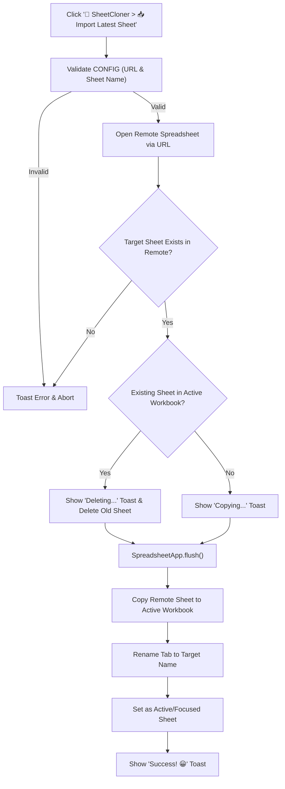

# 📑 SheetCloner — Remote Sheet Importer & Auto-Replacer for Google Sheets™

A lightweight, zero-dependency Google Apps Script utility that seamlessly imports and replaces a specific tab from an external Google Spreadsheet into your active workbook.

When running recurring reporting, data consolidation, or distributed workflows, duplicating sheets manually creates cluttered `(Copy of...)` tabs and broken cross-references. **SheetCloner** automates the sync cycle: safely deleting the outdated version, copying the fresh tab, restoring the original sheet name, and focusing the new sheet with real-time UI feedback.

---

## 🎯 Key Features

- **⚡ Automatic Detection & Replacement**: Safely identifies if an older version of the tab exists, purges it, and swaps in the fresh version without creating duplicate `(Copy of ...)` sheets.
- **🛠️ Native Custom Menu Integration**: Registers a `📑 SheetCloner` menu in the Google Sheets toolbar upon opening for convenient 1-click execution.
- **💬 Real-Time Toast Notifications**: Keeps users informed at each stage (validating, deleting, copying, success, or error) using non-intrusive Google Sheets UI toasts.
- **🛡️ Robust Error Handling & Diagnostics**: Validates configuration before execution and logs actionable error messages directly to the Apps Script execution log.
- **🔒 Zero Third-Party Dependencies**: Pure Google Apps Script running entirely within Google Workspace infrastructure.

---

## 🔄 Workflow



---

## ⚙️ Configuration Reference

All settings are configured inside the `CONFIG` object at the top of [`Code.gs`](file:///Users/sumitsingh/Developer/google-apps-script/projects/SheetCloner/Code.gs):

```javascript
const CONFIG = {
  SOURCE_SHEET_URL: 'https://docs.google.com/spreadsheets/d/YOUR_SOURCE_SHEET_ID/edit', // URL of the external spreadsheet
  SHEET_NAME: 'Monthly Report',                                                         // Exact tab name to import
  TOAST_DURATION: 3,                                                                    // Seconds to display status toasts
  MESSAGES: {
    DELETING: 'Existing sheet found. Deleting the current version...',
    COPYING: 'No existing sheet found. Copying the new sheet...',
    SUCCESS: 'Sheet copied successfully! 😀',
    ERROR: 'Failed to import. Check URL, sheet name, and access permissions. 😥'
  }
};
```

| Parameter | Type | Required | Description |
| :--- | :--- | :---: | :--- |
| `SOURCE_SHEET_URL` | `string` | **Yes** | Full web URL of the source Google Spreadsheet. |
| `SHEET_NAME` | `string` | **Yes** | Exact name of the specific tab to copy. Case-sensitive. |
| `TOAST_DURATION` | `number` | Optional | Duration in seconds for UI toast banners (default: `3`). |
| `MESSAGES` | `object` | Optional | Custom user-facing status messages for each operation phase. |

---

## 🚀 Setup & Installation

1. **Open Destination Sheet**: Open the Google Spreadsheet you want to import data *into*.
2. **Open Script Editor**: Navigate to **Extensions** > **Apps Script** in the top navigation bar.
3. **Paste Code**: Replace the default editor code with the contents of [`Code.gs`](file:///Users/sumitsingh/Developer/google-apps-script/projects/SheetCloner/Code.gs).
4. **Configure Parameters**: Fill in `SOURCE_SHEET_URL` and `SHEET_NAME` within the `CONFIG` object.
5. **Save Project**: Click the 💾 **Save project** icon (or press `Cmd + S` / `Ctrl + S`).
6. **Reload Spreadsheet**: Reload the spreadsheet tab in your browser. You will see the `📑 SheetCloner` menu appear in the toolbar.
7. **Authorize Permissions**: Click **📑 SheetCloner** > **📥 Import Latest Sheet**. On the first run, grant the required Google Workspace permissions.

---

## 📋 Permissions & Access Requirements

- The Google account running the script must have at least **Viewer** access to the source spreadsheet and **Editor** access to the active destination spreadsheet.
- Standard Apps Script OAuth scopes required:
  - `https://www.googleapis.com/auth/spreadsheets` (Spreadsheet read and write access).

---

## 📄 License

This project is open-source under the [MIT License](LICENSE).
